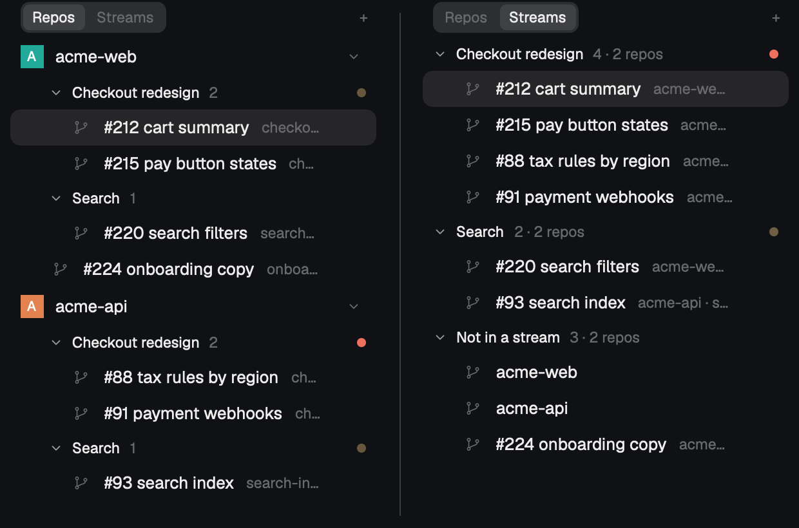
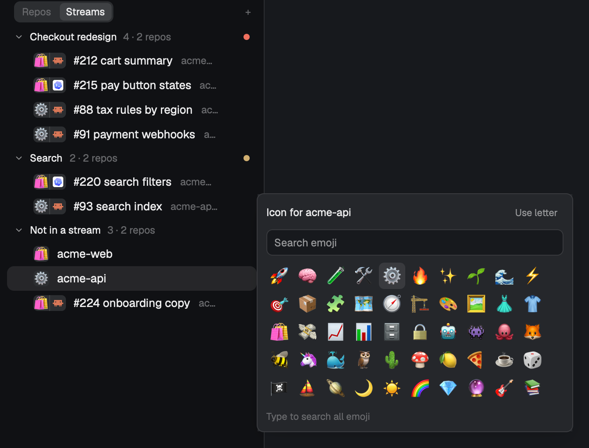

# Space Streams

**Install: paste this to your agent inside Herdr**

```text
Read ~/.config/herdr-app/AGENTS.md, then add the Herdr mod at https://github.com/geooff/herdr-space-streams
and make it my Spaces sidebar. Follow the "For agents" section of its README.
```

---

Herdr's Spaces sidebar, rebuilt for running many agents at once:

- **Groups:** a repo's worktree spaces fold into named groups.
- **Streams:** flip the toggle to see one effort across every repo. Groups with the same name in different repos merge into one work stream.
- **Repo emoji:** every row shows its repo's emoji next to its agent's icon, so in a mixed stream you can tell at a glance which repo and which agent each space is.
- **Agents file themselves:** `hc label "$HC_TERMINAL_ID" herdr.group="<stream name>"`.





| | |
|---|---|
| Click a group or stream header | fold it (it still shows the space you're in, and a dot if a hidden agent is blocked or done) |
| Double-click or right-click a header | rename, ungroup, collapse others |
| Right-click a worktree → **Move to group…**, or `cmd-shift-g` | pick a group, join a stream from another repo, or name a new one |
| Drag a worktree onto a header | move it in |
| Click an avatar, or `cmd-shift-e` | pick the repo's emoji (macOS emoji search) |
| `alt-up` / `alt-down` (in the `main-streams` layout) | the space above / below, in the order the list shows |

It works on its own. With [herdr-one-agent-one-worktree](https://github.com/geooff/herdr-one-agent-one-worktree) installed, a repo's `+` opens that flow. Without it, `+` opens Herdr's own worktree dialog. [RECIPE.md](RECIPE.md) describes exactly what it does and how it's built. It's based on Herdr's shipped `spaces` and `menu` mods.

## Install by hand

```sh
git clone https://github.com/geooff/herdr-space-streams.git ~/src/herdr-space-streams
cd ~/src/herdr-space-streams
for m in space-streams space-streams-menu space-group emoji-picker; do
  mkdir -p ~/.config/herdr-app/mods/$m
  cp mods/$m/mod.json ~/.config/herdr-app/mods/$m/   # mod.json first, so Herdr doesn't dock it
  cp -R mods/$m/. ~/.config/herdr-app/mods/$m/
done
cp layouts/main-streams.json ~/.config/herdr-app/layouts/
herdr-app do layout.switch --name main-streams
```

Then merge `keys.json` into `~/.config/herdr-app/keys.json`. `main-streams` is Herdr's own `main` layout (0.1.12) with the Spaces block swapped for this mod, and `ctrl-shift-l` switches back. In a layout of your own, set the Spaces block to `"content": { "mod": "space-streams" }`, and copy the `layout:main-streams` keys into a `layout:<your layout>` section.

Copy rather than symlink: Herdr doesn't reload a mod from a symlinked folder when its files change.

## For agents

You're installing this into the person's Herdr home (`~/.config/herdr-app`, or `$HERDR_APP_HOME`). Read its `AGENTS.md` first.

1. **Tell the person first:** this mod runs `git` in their spaces' folders, `hc machine ls`, and `python3` (macOS emoji search data). It also writes `data/space-groups.json` in the Herdr home.
2. **Copy the mods:** copy `mods/space-streams`, `mods/space-streams-menu`, `mods/space-group` and `mods/emoji-picker` into `<home>/mods/`. Write each folder's `mod.json` before its `main.js`, because Herdr docks a folder it sees without one. If a name is already taken, rename the new one and every reference to it, and tell the person.
3. **Merge keys:** merge `keys.json` into `<home>/keys.json` (`cmd-shift-g` → `space-streams.group`, `cmd-shift-e` → `mod.open:emoji-picker`). Ask before replacing a key they already use.
4. **Make it the sidebar:** find the layout they use (`herdr-app status` → `layout`).
   - If it's Herdr's `main`, copy `layouts/main-streams.json` into `<home>/layouts/` and `herdr-app do layout.switch --name main-streams`. The `layout:main-streams` keys in `keys.json` then make next/previous space follow the list.
   - If it's their own layout, change its Spaces block's `"mod"` (`spaces` or their own spaces mod) to `"space-streams"`, and copy the `layout:main-streams` keys into a `layout:<their layout>` section. Check `layout.error` afterwards.
5. **Check:** run `herdr-app check` on each of the four folders and `herdr-app status` (no errors). Take a `herdr-app shot` and confirm the sidebar shows the **Repos | Streams** toggle.
6. **Agent rule (ask first):** offer to add this to the person's agent instructions (e.g. `~/.claude/CLAUDE.md` or `AGENTS.md`):

   > **Herdr work streams.** When you run inside Herdr in a repo worktree, read `~/.config/herdr-app/data/space-groups.json` and join the work stream your work belongs to: `hc label "$HC_TERMINAL_ID" herdr.group="<exact stream name>"`. Reuse an existing name character for character, even one from another repo. Only make a new one when nothing fits, and name the effort, not your slice of it. Skip this for one-off tasks. If you start other agents for a batch, choose the stream name yourself and put it in each one's prompt.

7. **Report back:** tell the person how to switch views, group a space (`cmd-shift-g`) and set an emoji (click an avatar), and how to undo: switch back with `ctrl-shift-l` (or point their layout back at `spaces`) and delete the four folders.

## Related mods

Other mods also organize the Spaces list. Pick whichever fits:

- **[jankeesvw/herdr-space-folders](https://github.com/jankeesvw/herdr-space-folders):** colored folders across all your spaces, smart folders filled by path rules, and folders saved per machine so every screen sees them. Use it if you want to organize spaces by hand or by folder.
- **[suppa-duppa-labs/herdr-space-groups](https://github.com/suppa-duppa-labs/herdr-space-groups):** group spaces by hand.
- **[choam2426/herdr-paddock](https://github.com/choam2426/herdr-paddock):** spaces by project, with agents and sub-agents under their space.
- **[juliorr/herdr-space-avatars](https://github.com/juliorr/herdr-space-avatars)** and **[balcsida/herdr-profile-pictures](https://github.com/balcsida/herdr-profile-pictures):** custom images or owner pictures for avatars.

What Space Streams adds:
- **Streams:** groups with the same name merge across repos into one view.
- **Agents group themselves:** with `hc label` (and `data/space-groups.json` to reuse names), so a batch of agents files itself into one stream without you dragging anything.
- **A repo mark beside each agent's icon:** in a stream mixing repos, you can still tell each row's repo at a glance.

## License

MIT (`LICENSE`). `mods/space-streams`, `mods/space-streams-menu` and `layouts/main-streams.json` started as copies of the `spaces` mod, `menu` mod and `main` layout that ship with [Herdr](https://herdr.dev), and that code keeps Herdr's Apache License 2.0 (`LICENSE-APACHE`). The two mods say at the top what was changed; the layout only swaps the Spaces block's mod.

`mods/space-streams/trash.svg` is the "trash-2" icon from [Lucide](https://lucide.dev) (ISC License).
