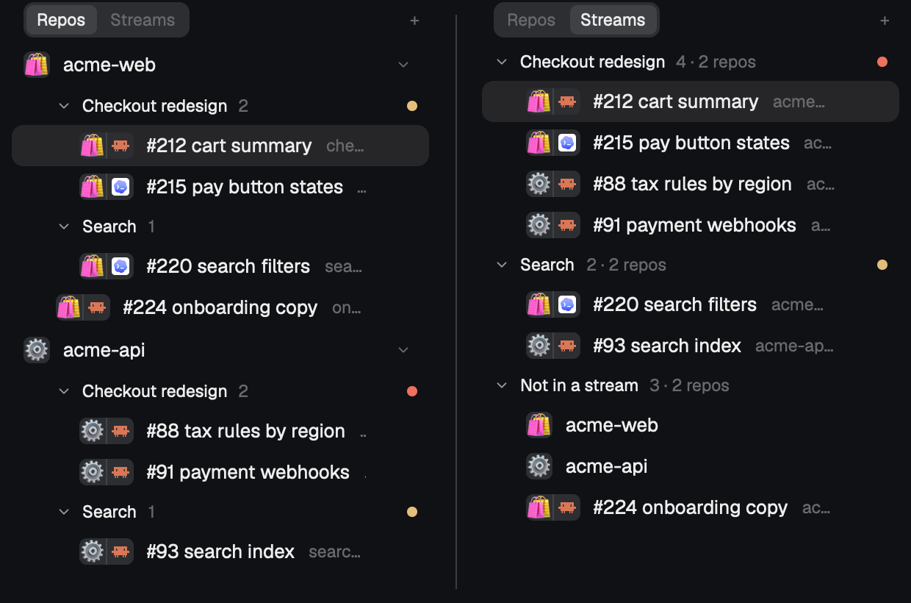
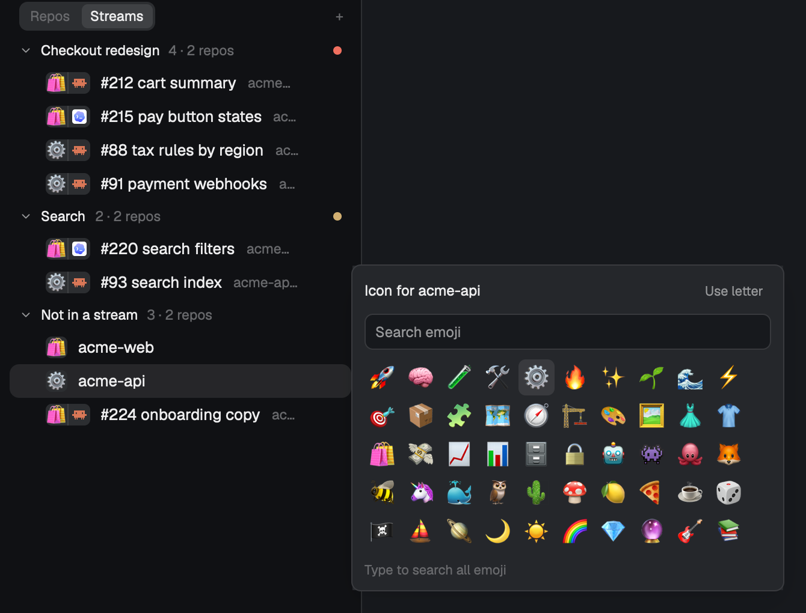

# Space Streams

A Spaces sidebar for people running many agents at once. A repo's worktree spaces go into named groups that fold away, and groups with the same name in different repos form one **work stream**. A Repos | Streams toggle at the top switches between "everything under its repo" and "everything in this effort, whatever repo it's in". Every repo can wear an **emoji**, and each row shows its repo's emoji next to its agent's icon. In a stream that mixes repos, that's how you tell at a glance which repo and which agent each space is. Agents can put themselves in a stream with one `hc label`.

## What you see

The sidebar, top to bottom (it replaces Herdr's `spaces` block, about 240–300 px wide, `chrome` background, 13 px text):

- **Header row (31 px):** a segmented toggle, `Repos` | `Streams`, 11.5 px. The selected half is on `selected` with `foreground` text and the other is `dim`, inside a `raised` pill with 2 px padding and 7 px corners. A `+` on the right makes a new space.
- **Repos view:** Herdr's usual list. Each repo's main checkout has a colored letter avatar, and its worktree spaces are nested under it (branch icon, 22 px indent). Inside a repo, its **groups** come first, oldest first:
  - **Group header (26 px):** chevron (down when open, right when folded), name in semibold `foreground`, member count in `dim`, and on the right a 7 px status dot.
  - **Group members:** indented 38 px.
  - Ungrouped worktrees come after the groups.
- **Streams view:** one header per stream, flush left: chevron, name, then "N" or "N · M repos". Its spaces from every repo are listed under it, each showing its repo name after its own name. Last comes **Not in a stream** with everything else.
- **Avatars (18 px, 5 px corners):** the repo's emoji, else its first letter in white on the repo's color. A space with an agent running shows two halves: the repo mark, then the agent's icon (Claude, Codex, …) on `raised`. Worktrees share their repo's emoji and color. In Repos view a worktree without an agent shows a branch icon. In Streams view every row shows its repo mark.
- **Emoji picker popup (360×300):** "Icon for <repo>" with a "Use letter" button, a search field, a 10-column grid of 30 px cells (50 starter emoji, or every search match up to 500), and a footer line with the hovered emoji's name or the match count.
- **Narrow rail (< 160 px):** spaces only, no group headers.

## How it behaves

- **Status dot on a header:** the most urgent agent status among its spaces: `blocked` (theme `blocked` color) > `done` > `working` (pulses, opacity 0.4→1 every 1.2 s) > `idle` (no dot). On a folded group, the dot only counts the spaces it hides.
- **Click a header** to fold or unfold it. A folded group or stream still shows the space you're in. Repos-view fold state is saved in shared state, and Streams-view fold state in the mod's localStorage.
- **Double-click or right-click a group header** to open the group dialog: rename, Ungroup, Collapse others. On a stream header it opens the stream dialog instead: rename (renames that group in every repo) or Ungroup all.
- **Right-click a worktree space** and choose **Move to group…**, or press `cmd-shift-g` for the shown space. The dialog lists the repo's groups (a ✓ on the current one), "Streams in other repos" (pick one to join it from this repo), Remove from group, and a field where Enter makes a new group.
- **Drag a worktree onto a group or stream header** to move it in. In the stream case, a group is made in that worktree's repo if it doesn't have one yet. In Repos view, dragging between rows still reorders spaces. In Streams view rows don't reorder.
- **Agents group themselves:** `hc label "$HC_TERMINAL_ID" herdr.group="Checkout redesign"`. Within a second the sidebar puts that terminal's space into the group of that name in the space's repo (matched case-insensitively), creating it if needed. A label only acts when its value changes, so moving a space by hand sticks. Main checkouts and spaces outside a repo are ignored.
- Closed spaces leave their group, and empty groups are deleted.
- `data/space-groups.json` (under the Herdr home) is rewritten whenever groups change: every repo's groups, and the space names in each. Agents read it to reuse an existing stream name.
- **Emoji:** click any avatar, or press `cmd-shift-e` for the focused space, to pick that repo's emoji. Search uses macOS's own emoji search, so "fox", "celebrate" or "coffee" find what the system picker finds. Picking sets it for the repo and all of its worktrees, and "Use letter" clears it.
- **Companion:** with [herdr-one-agent-one-worktree](https://github.com/geooff/herdr-one-agent-one-worktree) (`new-workspace`) installed, a repo's `+` opens it. Otherwise `+` opens Herdr's shipped worktree dialog. Worktree `×` always uses the shipped worktree remove dialog.

## Built from

- `mods/space-streams`: the sidebar. It started as a copy of Herdr's shipped `spaces` mod (git status, ahead/behind, pull button, machine headers, drag-to-reorder are all from it). `mod.json` has `place: "none"`. Props: `{ under?: "<folder>" }` shows only spaces whose folder is inside it.
  - **Group state:** `shared("space.groups")` = `{ groups: {id: {name, repo, collapsed, created}}, members: {spaceId: groupId}, tags: {spaceId: last label applied} }`. `repo` is `JSON.stringify([machine, absolute git common dir])`, the same key the sidebar already uses to nest worktrees.
  - **Mod commands:** `space-streams.group` opens the dialog for the shown space, and `space-streams.view` switches views.
  - **Agent labels:** a 1 s timer reads `terminals()` labels (`herdr.group`, `herdr.space`).
  - **Herdr calls used:** `spaces()`, `panes()`, `terminals()`, `exec("git", …)`, `hc(["machine","ls"])`, `space.select`, `space.move`, `space.new`, `openOverlay`, and `fs/promises` `writeFile` for `data/space-groups.json`.
- `mods/space-group`: the dialog (`kind: "dialog"`, 420×380). Props: `{ space }`, `{ group }` or `{ stream }`. It runs `git rev-parse --git-common-dir` in the space's folder to find its repo.
- `mods/space-streams-menu`: the space right-click menu. It's a copy of Herdr's `menu` with **Move to group…** added for worktree spaces. It uses the shipped `worktree` dialog.
- `mods/emoji-picker`: the popup (`place: "none"`, overlay 360×300). Props: `{ key, name }`. Without props it targets the focused space's repo. Choices live in `shared("space.emoji")` as `{ [key]: "🦊" }`, where a repo's key is the same `[machine, git common dir]` JSON and a space outside a repo uses `space:<id>`. `system-index.py` prints macOS's emoji search data (CoreEmoji framework resources) as JSON, and the picker runs it once with `python3 -I`.
- **Agent icons:** from `panes()[i].program` (`agent` and `icon`), the same table Herdr's Agents list uses.
- `keys.json`: `cmd-shift-g` → `space-streams.group`, `cmd-shift-e` → `mod.open:emoji-picker`.
- **Icons:** the shipped `mods/workspace-chrome/*.svg`.

## Install

1. Copy the four `mods/` folders into your Herdr home's `mods/`, `mod.json` first. Herdr docks a folder it sees without one.
2. Merge `keys.json` into yours.
3. Clone your layout (`herdr-app do layout.clone '{"name":"main","as":"my-layout"}'`) and change the `spaces` block's `"mod": "spaces"` to `"mod": "space-streams"`.
4. Optional: tell your agents about it. For example, in `~/.claude/CLAUDE.md`:

   > When you run inside Herdr in a repo worktree, read `~/.config/herdr-app/data/space-groups.json` and join the work stream your work belongs to with `hc label "$HC_TERMINAL_ID" herdr.group="<exact stream name>"`. Reuse an existing name character for character, even from another repo. Only make a new one when nothing fits, and name the effort, not your slice of it.

## Watch out

- **Runs programs:** `git` in each space's folder (on its machine for remote spaces), `hc machine ls`, and `python3` for emoji search (reading macOS system files). Off macOS, emoji search shows "Search unavailable" but the starter grid still works. It writes one file outside its folder: `data/space-groups.json` in the Herdr home.
- Rows in the list that aren't spaces (group headers) still need to be counted in drag geometry. Every drawn row carries a `key` (space id or `grp:<id>`), and a drag shifts rows by key.
- A worktree only nests (and can be grouped) once the sidebar has seen its main checkout as a space. With the main checkout closed, its worktrees show flat at top level and their groups aren't drawn in Repos view (they still are in Streams).
- Group names are matched case-insensitively and trimmed. "Props" and "Props & scenes" are different streams, so tell agents to copy names exactly.
- Streams across machines are drawn under this computer's block only.
- `cmd-shift-g` is a macOS binding. On Linux or Windows pick another.

## Done when

- The header shows Repos | Streams, and clicking either half switches the list. `herdr-app do space-streams.view` does too.
- `hc label <a worktree space's terminal> herdr.group="Test"` makes a **Test 1** header under that repo within a second, and `data/space-groups.json` lists it.
- Labelling a worktree in a second repo with the same name shows **Test 2 · 2 repos** in Streams view.
- Clicking the header folds it to one row (plus the shown space). A blocked agent in a folded group shows a dot.
- Right-click → Move to group… → typing a new name and Enter moves the space under a new header. Remove from group puts it back, and the empty group disappears.
- Closing a grouped space removes it from the group.
- Clicking a repo's avatar opens "Icon for <repo>". Typing "fox" finds 🦊, and picking it shows 🦊 on the repo and every worktree. In Streams view, a row with an agent shows 🦊 plus the agent's icon.
- `herdr-app check` passes for all four mods.
